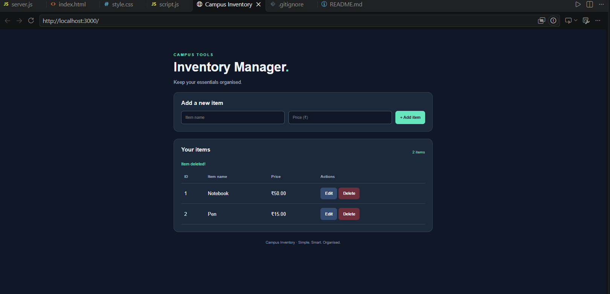

# Campus Inventory Manager

## About
A simple inventory management website that performs CRUD
operations on an array of items using HTML, CSS, JavaScript,
Express.js and REST APIs.

## Features
- Add new items
- View all items
- Edit item details
- Delete items
- Responsive user interface

## Technologies Used
- HTML and CSS
- JavaScript
- Node.js
- Express.js
- REST API

## How to Run
1. Install Node.js.
2. Run `npm install express`.
3. Run `node server.js`.
4. Open http://localhost:3000 in your browser.

## API Endpoints

| Method | Endpoint | Operation |
|---|---|---|
| GET | /api/items | View items |
| POST | /api/items | Add item |
| PUT | /api/items/:id | Update item |
| DELETE | /api/items/:id | Delete item |

## Output Screenshot

